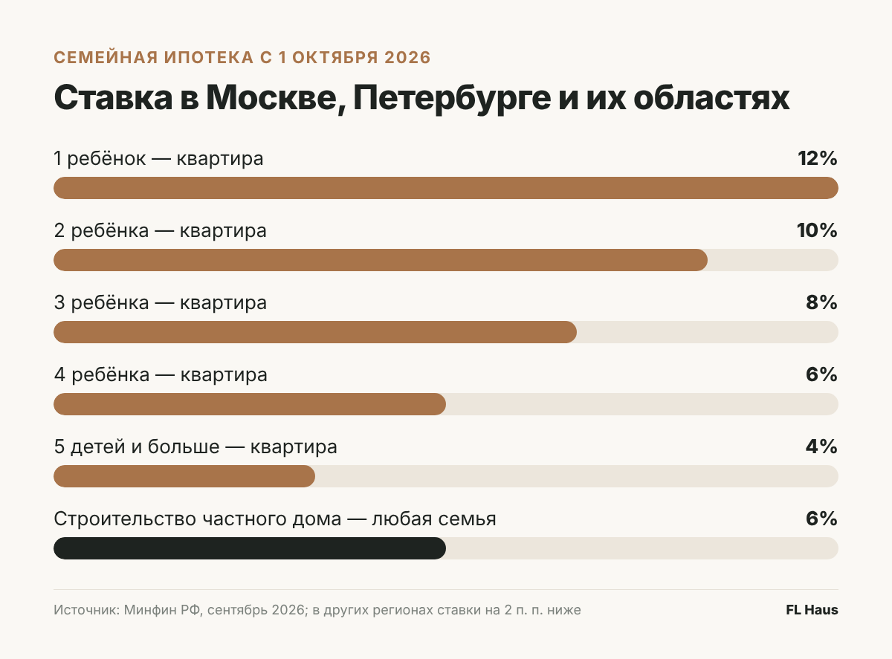
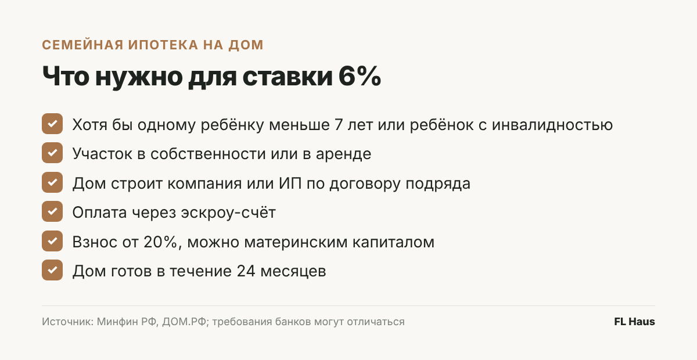
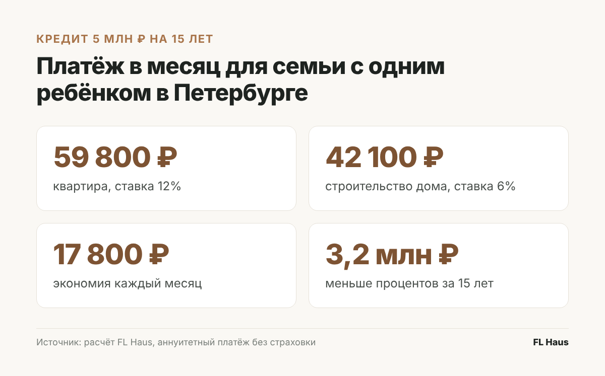

С 1 октября 2026 года семейная ипотека перестала быть одинаковой для всех. Ещё в сентябре ставка была 6% у любой семьи с ребёнком младше семи лет. Теперь она зависит от того, сколько в семье детей и в каком регионе покупается жильё. Семья с одним ребёнком в Петербурге или Москве получит кредит на квартиру под 12% — ставка выросла ровно вдвое.

Но в новых правилах есть исключение, о котором пишут мелким шрифтом. Если семья строит частный дом или покупает участок и строит на нём, ставка остаётся 6% — при любом числе детей и в любом регионе.

Разберёмся, что поменялось, кого касается исключение и сколько оно экономит в рублях.

## Что изменилось с 1 октября

Новые условия действуют для кредитов, оформленных с 1 октября. Тем, кто подписал договор раньше, ставку не меняют.

В Москве, Подмосковье, Петербурге и Ленинградской области шкала теперь такая. С одним ребёнком — 12% и кредит до 12 млн рублей. С двумя — 10% и до 15 млн. С тремя — 8%, с четырьмя — 6%, с пятью и больше — 4%, лимит для многодетных — до 18 млн. В остальных регионах ставки на два пункта ниже, а лимиты меньше: от 6 млн рублей для семьи с одним ребёнком до 10 млн для многодетных.

Льготу ещё и сократили по времени: государство субсидирует ставку не больше 15 лет. Право на программу осталось у тех же семей — где хотя бы одному ребёнку нет семи лет или где растёт ребёнок с инвалидностью.

## Почему для домов сделали исключение

Логика Минфина понятна: льготную ипотеку слишком часто брали на студии и однушки — под сдачу или перепродажу. Поэтому ставку подняли там, где спрос перегрет, и оставили низкой там, где семья действительно получает больше места.

Частный дом попал во вторую группу. Ставка 6% сохраняется на строительство дома, на его завершение и на покупку участка, если на нём потом строится дом. Ещё 6% оставили семьям, которые вносят половину стоимости и больше из своих денег, и семьям с ребёнком-инвалидом.

## Что нужно, чтобы получить 6% на дом

Денег на стройку «своими руками» программа не даёт. Банк выдаст кредит, если дом строит подрядчик — компания или ИП — по договору, а оплата идёт через эскроу-счёт. Участок должен быть в собственности или в аренде у заёмщика, а дом — построен в течение 24 месяцев после выдачи кредита. Первоначальный взнос — от 20%, и его можно закрыть материнским капиталом.

Эскроу работает на семью. Деньги лежат в банке, подрядчик получает их только после сдачи дома. Если стройка встанет, деньги вернутся. Точные требования к договору и участку у каждого банка свои, поэтому их лучше уточнить до подачи заявки.

## Сколько это в рублях

Возьмём для примера семью из Петербурга с одним ребёнком. Им нужно жильё примерно за 6,2 млн рублей. Взнос — 20%, в кредит — около 5 млн на 15 лет.

Если это квартира, ставка теперь 12%, и платёж составит около 59 800 рублей в месяц. Если это дом, который строит подрядчик, ставка 6% и платёж около 42 100 рублей. Разница — почти 17 800 рублей каждый месяц. За 15 лет семья отдаст банку процентов на 3,2 млн рублей меньше.

## Где здесь подвох

Обычная стройка в ипотеку — это всё равно стройка: проект, смета, бригада, погода, сезон. Срок в 24 месяца даёт время подрядчику, но для семьи это риск. Дом может расти два года, пока она платит и ипотеку, и аренду.

Поэтому всё больше семей смотрят на дома, которые делают на заводе. Петербургская компания FL Haus с 2015 года собирает модульные дома в цехе в Мурино — сразу с отделкой, электрикой, вентиляцией и полностью готовым санузлом, — а потом привозит модули и ставит их на сваи. На участке дом собирают за 5–14 дней, всего таких домов построено больше 700. Компания аккредитована в Сбере, ДОМ.РФ и ВТБ, через которые оформляют семейную ипотеку, и работает через эскроу.

Цифры из расчёта выше — как раз такая смета. Дом на 43 квадратных метра со спальней и кухней-гостиной при покупке в ипотеку стоит 5,45 млн рублей. Доставка и свайный фундамент под Петербургом — ещё 787 тысяч. Итого 6,23 млн, а платёж под 6% — около 42 тысяч в месяц. Самый компактный дом линейки стоит от 1,6 млн рублей. С доставкой и фундаментом в ипотеку он обойдётся примерно в 2,15 млн, и платёж на тех же условиях — около 14 500 рублей.

Ещё одна деталь по срокам. С 26 октября компания поднимает цены на дома на 5%. Договор, подписанный до этой даты, фиксирует текущую стоимость.

## С чего начать, если вы думаете о доме

Сначала проверьте, подходите ли вы под программу: возраст младшего ребёнка считается на дату подписания кредитного договора. Потом решите вопрос с землёй — без участка в собственности или в аренде банк кредит на дом не выдаст. Дальше выбирайте подрядчика, который работает через эскроу и аккредитован в вашем банке, и считайте полную стоимость: дом, фундамент, доставку, подключение света и воды на участке. Разница между ценой «от» и итоговой суммой у разных подрядчиков бывает в разы.

И главное — посмотрите дом вживую, прежде чем подписывать. Готовые дома FL Haus стоят на выставочных площадках: в Петербурге — на 1-й Полевой улице, 25А, и в Кудрове, на Мурманском шоссе, 5А; в Москве — в Мытищах и у метро «Курская». Площадки работают каждый день, консультация по ипотеке бесплатная.

*Условия программы — по сообщениям Минфина, опубликованным [Интерфаксом](https://www.interfax.ru/business/1118280) и [Коммерсантом](https://www.kommersant.ru/doc/8990210), проверены 9 октября 2026 года. Платёж рассчитан как аннуитетный, без учёта страховки. Ставка и лимит для конкретной семьи определяются банком.*
