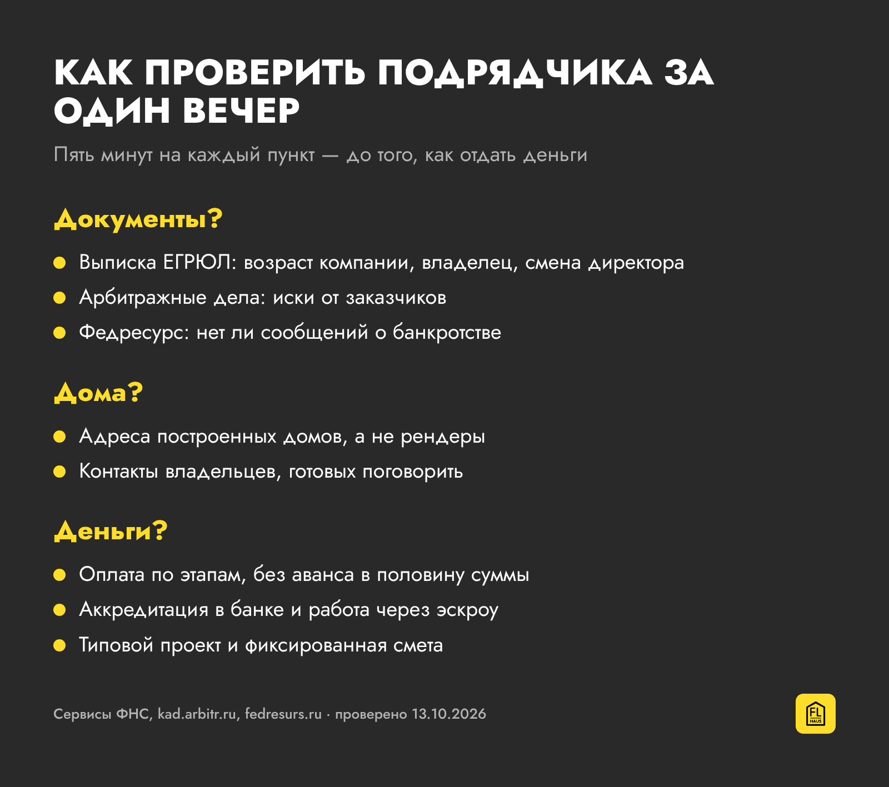
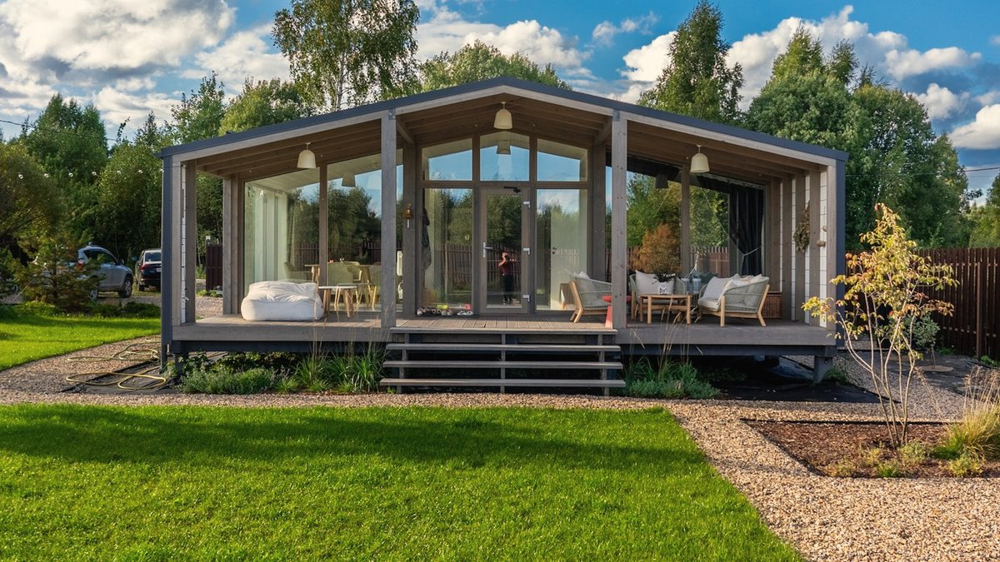

Алёна и её семья нашли участок мечты: лес, вода рядом, 120 километров от Москвы. Хотели каркасный дом на 128 квадратов с большой верандой. Нашли строительную фирму, подписали договор на 3 миллиона и внесли аванс — 2 миллиона. Чтобы его собрать, взяли кредит.

По договору дом должен был стоять уже в октябре. Фундамент начали только в конце сентября. К декабрю работа встала. Строители каждый раз объясняли задержку по-новому, а потом просто перестали брать трубку. Часть стен и кровли успели поставить. Остальное так и не сделали.

Когда семья наняла юристов, выяснилось: фирма банкрот, и таких, как они, больше десятка. Деньги вернуть не удалось. Дом достраивали с другой бригадой, многое — забор, откосы, укрепление фундамента на склоне — делали своими руками. Почти готов к жизни он был только через пару лет. Всё вместе обошлось примерно в 4 миллиона — и в несколько лет нервов.

Эту историю Алёна Шевченко рассказала «Циан.Журналу». Мы пересказываем её не ради страшилки. За пять лет схема не изменилась, а людей, которые прямо сейчас выбирают подрядчика, стало намного больше.

## Почему это важно именно сейчас

С 1 октября 2026 года семейная ипотека на квартиры подорожала: в Петербурге и Москве ставка для семьи с одним ребёнком выросла до 12%. Для строительства частного дома она осталась 6% при любом числе детей. Частные дома и так были на подъёме: по данным ДОМ.РФ, за январь—июль банки выдали 69 тысяч ипотечных кредитов на ИЖС — примерно в полтора раза больше, чем годом раньше.

Спрос растёт быстрее, чем число надёжных компаний. По оценке Сбера, которую приводит журнал «Эксперт», после введения эскроу и волны банкротств строительных компаний рынок частных домов заметно сократился. Люди всё чаще строят сами или нанимают отдельные бригады. А значит, и историй, как у Алёны, станет больше.

## Где была ошибка

Сама Алёна потом назвала две главные ошибки, и с ними трудно спорить.

Первая — большой аванс. Две трети суммы ушли фирме до того, как на участке появился фундамент. Когда компания ушла в банкротство, эти деньги просто растворились среди её долгов.

Вторая — индивидуальный проект. Только на согласование планировки ушло полтора месяца. Каждый нестандартный узел — это время, новые расчёты и повод для задержки. В типовом проекте всё это уже посчитано и много раз построено.

Есть и третья ошибка, о которой в истории говорится между строк: фирму никто толком не проверил. А на это хватает одного вечера.

## Как проверить подрядчика за один вечер

Начните с документов. Попросите у компании ИНН и посмотрите её в выписке ЕГРЮЛ на сайте налоговой: сколько ей лет, кто владелец, не меняли ли недавно директора. Затем найдите её в картотеке арбитражных дел — десяток исков от заказчиков говорит больше любого сайта. И проверьте Федресурс: там публикуют сведения о начатом банкротстве.

Потом — реальные дома. Попросите не рендеры, а адреса построенных домов и контакты владельцев, которые готовы рассказать, как всё прошло. Хорошая компания организует такую встречу. Если вас уверяют, что «все клиенты против», это повод насторожиться.

Дальше — деньги. Смотрите, как оплата привязана к этапам. Аванс в половину или две трети суммы до начала работ — красный флаг. И уточните, есть ли у компании аккредитация в банках: банк перед этим проверяет подрядчика сам.

## Эскроу: деньги ждут в банке

Самую большую дыру из истории Алёны закрывает эскроу. С 1 марта 2025 года действует закон № 186-ФЗ, который ввёл эскроу-счета в частное домостроение. Схема простая: вы кладёте деньги на специальный счёт в банке, а подрядчик получает их только после того, как дом построен и право собственности зарегистрировано. Если компания исчезнет на полпути, деньги не уйдут на её долги.

Для своих денег эскроу — добровольная договорённость с подрядчиком. А если вы строите по семейной ипотеке с подрядчиком, оплата идёт только через эскроу: это условие программы. Поэтому на вопрос «как выбрать подрядчика для строительства дома в ипотеку» есть короткий ответ — того, кто аккредитован в вашем банке и работает через эскроу. Иначе банк просто не выдаст кредит.

## Как это выглядит, когда дом строят на заводе

Есть способ убрать с дороги и долгую стройку на участке, и бригаду, которая может пропасть. Дом собирают в цеху, а на участок привозят уже готовым.

Так работает, например, петербургская компания FL Haus. С 2015 года она построила больше 700 модульных домов. Модули делают на своём производстве в Мурино: сразу с отделкой, электрикой, сантехникой и вентиляцией. На участке их соединяют и подключают за 5–14 дней. Все проекты типовые, поэтому смету не нужно придумывать заново — её считали уже сотни раз.

С ипотекой компания работает через эскроу и аккредитована в Сбере, ДОМ.РФ, ВТБ и других банках. Если платить своими деньгами, оплата разбита на этапы, и последние 30% вносятся после приёмки дома на производстве и на участке. До договора можно приехать на выставочную площадку, походить по готовому дому, посмотреть производство по записи и поговорить с владельцами — компания организует такие встречи.

## Чем закончилась история

Семья Алёны всё-таки достроила дом. Многое пришлось освоить самим, и в конце рассказа она советует не бояться браться за новое. Но если бы можно было начать сначала, они выбрали бы типовой проект и не отдали бы крупный аванс компании, которую толком не проверили.

Стройка — это не только кирпичи и доски. Это год-два жизни, кредит и нервы всей семьи. Поэтому выбирать подрядчика стоит так же внимательно, как участок, и не стесняться задавать неудобные вопросы.

Если хотите сначала посмотреть, как выглядит готовый модульный дом изнутри, приезжайте вживую.

Адреса выставочных площадок FL Haus — работают каждый день, консультация бесплатная:

- 📍 **Санкт-Петербург,** 1-я Полевая улица, 25А (м. Удельная)
- 📍 **Кудрово,** Мурманское шоссе, 5А
- 📍 **Мытищи,** Ярмарочная улица, Выставка малоэтажного домостроения
- 📍 **Москва,** Басманный район, у метро «Курская»

Источники: история семьи — «[Циан.Журнал](https://www.cian.ru/stati-lichnyj-opyt-esli-strojfirma-kidaet-luchshe-vse-vzjat-v-svoi-ruki-318664/)», 2021; данные ДОМ.РФ — «[РБК Недвижимость](https://realty.rbc.ru/news/6a8d69259a794769ee3b37b8)»; мнение Сбера — «[Эксперт](https://expert.ru/nedvizhimost/izhs-sokhranili-lgotnuyu-stavku)». Проверено 13 октября 2026 года.
{: .src}
